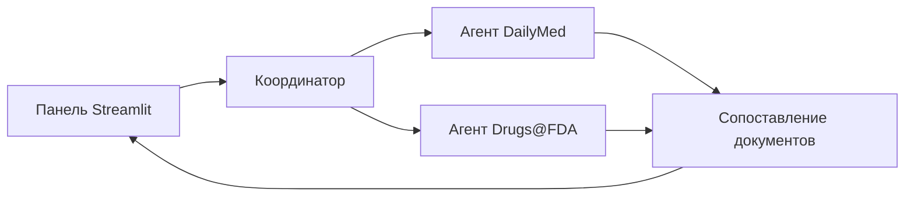

# Противопоказания к лекарствам

Учебное мультиагентное приложение курса «Программная инженерия мультиагентных систем в клинической медицине». Оно находит раздел **Contraindications** в инструкциях для рынка США и показывает ссылки на документы. Для работы нужны интернет и Python 3.12. Доступ к источникам бесплатный, ключ модели не требуется.

## Локальный запуск

```powershell
python -m venv .venv
.\.venv\Scripts\python.exe -m pip install -r requirements.txt
.\.venv\Scripts\python.exe -m streamlit run streamlit_app.py
```

В macOS и Linux используйте `.venv/bin/python` вместо `.\.venv\Scripts\python.exe`. Откройте адрес, который выведет Streamlit, и введите `Fortamet` или `metformin`. При нескольких совпадениях выберите нужную инструкцию.

## Архитектура



- **Агенты источников** в `drug_search/dailymed.py` и `drug_search/fda.py` получают записи и извлекают текст. Первый читает структурированный SPL и выбирает раздел по коду `34070-3`. Второй использует метаданные заявок FDA, выбирает наиболее свежую утверждённую инструкцию среди доступных документов и извлекает соответствующий раздел из PDF.
- **Координатор** в `drug_search/coordinator.py` запускает независимые поиски параллельно. При выборе SPL он сопоставляет заявку FDA, название, состав, форму и путь введения. Когда совпадение неоднозначно, координатор возвращает статус сверки и доступный документ. Интерфейс также позволяет открыть вариант из Drugs@FDA напрямую.
- **Контракты** в `drug_search/models.py` описывают кандидатов, документы, статусы и результат. `streamlit_app.py` отображает эти данные и хранит выбранный результат в сеансе.

Панель Streamlit, независимые агенты с единым форматом ответа и оркестратор заимствованы из структуры учебного трекера публикаций. Третья лекция описывает цепочки со структурированным выходом, маршрутизацию и параллельное выполнение. В этом проекте маршрутизация следует за выбором документа, а начальный поиск выполняется одновременно в двух источниках. Текст разделов извлекается по правилам, с сохранением формулировок и ссылок. [Код примера](https://github.com/EdwFa/MAS/tree/main/Лекция_3), [цепочки](https://edwfa.github.io/mas-lecture/lecture/03/slide-03.html?v=7), [маршрутизация](https://edwfa.github.io/mas-lecture/lecture/03/slide-08.html?v=7), [параллельное выполнение](https://edwfa.github.io/mas-lecture/lecture/03/slide-10.html?v=7)

## Источники и покрытие

- DailyMed публикует инструкции, представленные производителями в FDA. Поиск ограничен первой страницей из 40 документов, при неполной выдаче приложение предлагает уточнить название. [Документация DailyMed](https://dailymed.nlm.nih.gov/dailymed/app-support-web-services.cfm)
- Drugs@FDA предоставляет данные об одобрениях и ссылки на часть утверждённых инструкций. Поиск по имени ограничен 30 заявками, а при наличии номера из SPL выполняется отдельный поиск по номеру. PDF может быть сканом или содержать нестандартную разметку. В таких случаях приложение показывает доступную ссылку и статус извлечения. [API Drugs@FDA](https://open.fda.gov/apis/drug/drugsfda/), [база FDA](https://www.accessdata.fda.gov/scripts/cder/daf/)
- Источники могут возвращать разные версии и исторические документы. Проверяйте дату, форму и статус продукта в карточке результата. Отсутствие результата или раздела означает, что приложение не смогло показать соответствующий текст. [Разъяснение FDA о версиях инструкций](https://www.fda.gov/drugs/laws-acts-and-rules/fdas-labeling-resources-human-prescription-drugs)

## Проверки и деплой

```powershell
.\.venv\Scripts\python.exe -m unittest discover -s tests -v
```

Тесты проверяют разбор SPL и текста PDF, сопоставление записей и поведение панели при нескольких результатах и сбое источника. Для проверки по живым данным найдите `Fortamet` и откройте обе ссылки из результата. Убедитесь, что показанный текст относится к разделу противопоказаний выбранной инструкции.

В Streamlit Community Cloud выберите этот репозиторий, ветку `main`, файл `streamlit_app.py` и Python 3.12. Облачному приложению не нужны секреты. [Документация Streamlit Community Cloud](https://docs.streamlit.io/deploy/streamlit-community-cloud/deploy-your-app/deploy)
